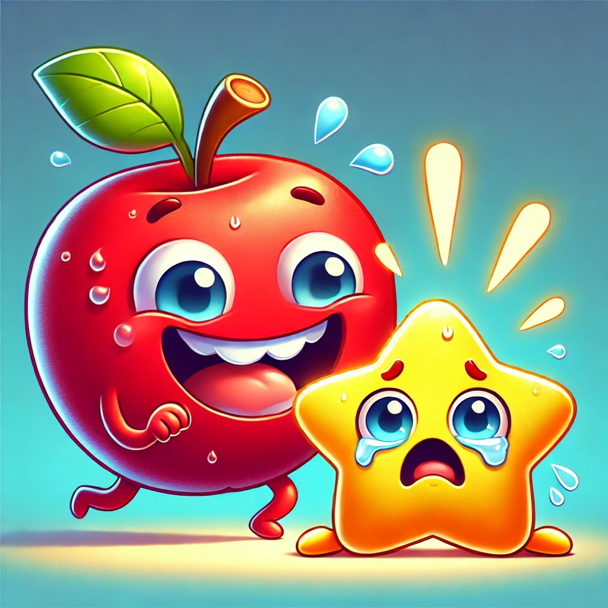

import Tabs from '@theme/Tabs';
import TabItem from '@theme/TabItem';

# 8. What role does saliva play in digestion ?

Saliva is essential for starting digestion by breaking down starch into simpler sugars right in your mouth.Use the mnemonics below to understand its roles.

<Tabs>
  <TabItem value="mnemonic" label="Mnemonics" default>

:::tip[Mnemonic 1]

**Smelly Apples Munch Starch**

  

:::

      **Explanation:**  
      This mnemonic helps remember the key roles of saliva and its key component:

      - **S**: Saliva
      - **M**: Moistens food (makes it easier to chew and swallow)
      - **A**: Amylase (the enzyme present in saliva)
      - **Munch**: Starts digestion
      - **S**: Starch (the complex carbohydrate that salivary amylase breaks down into simpler sugars)
---

:::tip[Mnemonic 2]

**SWEET START**

:::

- **S** = Saliva
- **W** = With
- **E** = Enzyme
- **E** = Enzyme amylase
- **T** = Transforms starch into sugars

**Explanation:** Saliva contains the enzyme salivary amylase (the SWEET START) which helps in the initial breakdown of starch into simpler sugars right in your mouth, giving digestion a sweet start.

  </TabItem>
  <TabItem value="analogy" label="Analogy">
    Coming soon.
  </TabItem>
</Tabs>

